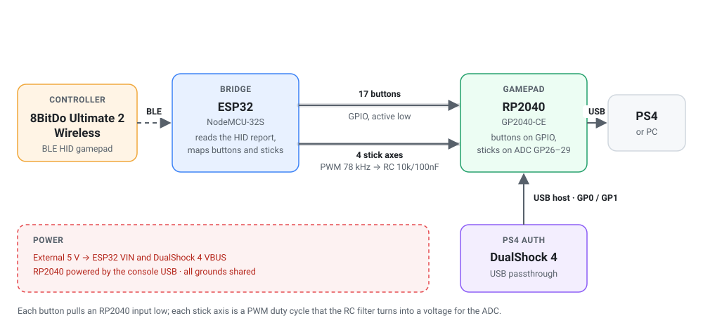

# 8BitDo Ultimate 2 Wireless to GP2040-CE Adapter

Use an **8BitDo Ultimate 2 Wireless** controller on a **PS4** (or PC) through **GP2040-CE**.

An ESP32 connects to the controller over Bluetooth LE, reads its HID report and drives the inputs of an RP2040 running GP2040-CE, as if the buttons and sticks were wired to it. GP2040-CE then does the console side: USB, PS4 mode and authentication.



## How it works

- **Buttons:** each of the 17 digital inputs is an open-drain output on the ESP32 that pulls the matching RP2040 input low when pressed.
- **Sticks:** each axis is an 8-bit PWM signal at 78 kHz, filtered by an RC (10k / 100nF) into one of the RP2040 ADCs (GP26–GP29).
- **PS4 authentication:** GP2040-CE forwards the console's challenge to an original DualShock 4 plugged into the RP2040 USB host port (GP0/GP1).
- **Disconnects:** if the controller drops, the ESP32 releases every input, centers the sticks and restarts to reconnect.

## Hardware

- ESP32 (NodeMCU-32S)
- RP2040 board with GP26–GP29 broken out (YD-RP2040 or similar; the official Pico has no GP29)
- 4× 10kΩ and 4× 100nF for the stick filters
- USB-A female connector for the DualShock 4
- Original DualShock 4 (for PS4 authentication)
- 5V supply, 1A or more
- Optional: LED + 330Ω on GPIO12 for status

The KiCad schematic and PCB live outside this repository.

### Wiring

| Input | ESP32 | RP2040 | GP2040-CE |
|---|---|---|---|
| A / B | GPIO13 / GPIO14 | GP6 / GP7 | B1 / B2 |
| X / Y | GPIO16 / GPIO17 | GP10 / GP11 | B3 / B4 |
| Up / Down | GPIO18 / GPIO19 | GP2 / GP3 | Up / Down |
| Left / Right | GPIO21 / GPIO22 | GP5 / GP4 | Left / Right |
| LB / RB | GPIO23 / GPIO27 | GP13 / GP12 | L1 / R1 |
| LT / RT (digital) | GPIO4 / GPIO5 | GP9 / GP8 | L2 / R2 |
| Share / Options | GPIO15 / GPIO2 | GP16 / GP17 | S1 / S2 |
| Home | GPIO0 | GP20 | A1 |
| L3 / R3 | GPIO1 / GPIO3 | GP18 / GP19 | L3 / R3 |
| Left stick X / Y | GPIO25 / GPIO26 | GP28 / GP29 (via RC) | Analog, left |
| Right stick X / Y | GPIO32 / GPIO33 | GP26 / GP27 (via RC) | Analog, right |
| DualShock 4 D+ / D− | — | GP0 / GP1 | USB host |

### Power

- **External 5V** → ESP32 VIN and the DualShock 4 USB-A VBUS.
- **RP2040** is powered by the console through its own USB port.
- **All grounds are shared.** Never tie the console VBUS to the external 5V.

Below about 4.5V at its input, the NodeMCU regulator can't hold 3.3V when BLE starts and the ESP32 browns out in a loop. Power it from a solid 5V supply.

## GP2040-CE configuration

Tested with GP2040-CE 0.7.12. Open the web configurator (hold S2/Start while plugging in, then go to `http://192.168.7.1`):

1. **Settings:** Input Mode **PS4**, authentication **USB**.
2. **Configuration → Peripheral Mapping → USB Host:** enabled, D+ = **0**, pin order D+ then D−, 5V enable pin = -1.
3. **Pin Mapping:** buttons as in the wiring table. Leave GP0 and GP1 unassigned.
4. **LED Configuration:** RGB data pin = **-1**. The default puts it on GP28, which fights the left stick X filter.
5. **Add-ons → Analog:** enabled, left stick on GP28/GP29, right stick on GP26/GP27.

Then plug the DualShock 4 into the USB-A port first and the RP2040 into the PS4. Don't press PS on the DualShock 4: it would pair over Bluetooth and take over player 1.

## Building and flashing

The firmware is a [PlatformIO](https://platformio.org/) project pinned to `espressif32@6.9.0` (Arduino-ESP32 2.0.17), because the LEDC calls it uses were removed in 3.x.

```bash
pio run -t upload
```

## Status LED (optional)

With an LED + 330Ω from GPIO12 to GND, the ESP32 blinks the reason for its last reset at boot:

| Pattern | Meaning |
|---|---|
| 3 fast | Brownout (supply too weak) |
| 2 slow | Software restart (controller not found or disconnected) |
| 1 slow | Normal power on |
| 5 fast | Anything else (crash, watchdog) |

The LED stays off while scanning and turns on once the controller is connected. Never put a pull-up on GPIO12: it's a boot strap pin and the ESP32 won't boot.

## Calibration

The RP2040 ADC on the tested board reads full scale at about 3.03V instead of 3.3V, so `src/pin_mapping.hpp` rescales each axis to rest at about 1.51V and reach both ends. If the sticks don't rest at 0 or don't reach ±1 on your board (check with [gamepad-tester.com](https://gamepad-tester.com)), adjust `STICK_IN_*`, `STICK_CENTER` and `STICK_OUT_*`.

## Known limitations

- **GPIO1 and GPIO3 (L3 / R3)** are also the ESP32 serial port. With `DEBUG_ENABLED` set in `src/debug.hpp`, L3 and R3 don't work and serial output toggles L3.
- **GPIO2 (Options)** also drives the NodeMCU's onboard LED, so that LED lights up when Options is pressed.
- The analog triggers are sent as digital L2/R2 only.
